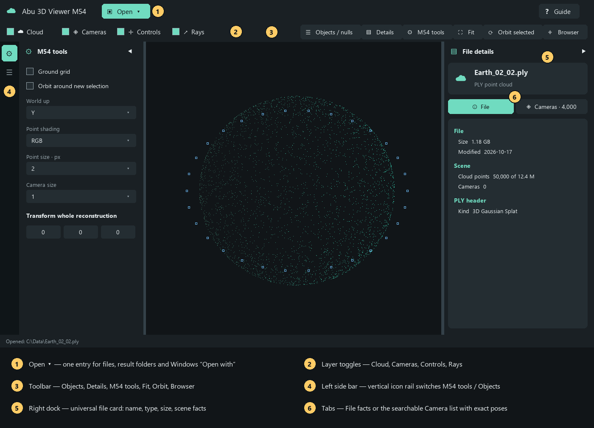
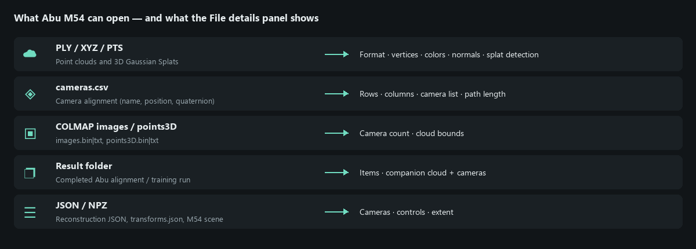
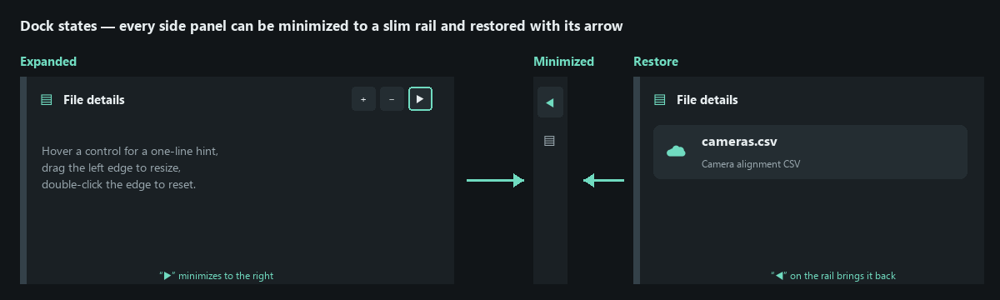

# ☁ Abu 3D Viewer M54 — Guide

Abu M54 is the shared GPU 3D viewer of **Abu Align & Train**. Open a point cloud, a camera list or a whole result folder, then orbit, inspect and compare it. Sources are never modified.

## ▣ Opening things

There is **one** entry point: the green **▣ Open ▾** button (shortcut `Ctrl+O`).

| Menu item | Use it when |
| --- | --- |
| ▣ File… | You have a single file: `.ply`, `cameras.csv`, `images.bin/txt`, `.json`, `.npz`, `.xyz`, `.pts` |
| ❐ Result folder… | You have a finished Abu alignment/training run; M54 finds the cloud and cameras by itself |
| ⚙ Add M54 to Windows ‘Open with’ | One-time setup: adds Abu M54 to Explorer’s right-click “Open with” list |

> The old *Open file*, *Run folder* and *Windows Open with* buttons are merged into this menu. Parsing happens in a separate process. The first GPU upload can still pause the native viewport; incremental uploading is planned with streaming.

## 3D Gaussian PLY preview

Open a conventional Gaussian `.ply` through **Open > File**. On Windows with
OpenGL 4.3 or newer, **3DGS GPU** renders all loaded Gaussians with their shape,
opacity and view-dependent color (SH degrees 0-3). The footer shows the full
Gaussian count, GPU processing time and allocated buffers. GPU time is not a
measurement of complete interaction FPS.

- Drag to orbit, use the wheel to zoom, and use the existing M54 transform tools.
- Uncheck **3DGS GPU** for a sampled point preview. Point color/size controls
  apply to this preview; Gaussian appearance uses the file's attributes.
- Browser view, A/B overlay, or a GPU failure explicitly show sampled points.
  A-only and B-only can show full Gaussians separately.
- Static frames have a 2 GiB GPU-buffer budget per frame. Larger assets
  report that limit and show the sampled preview; they are not silently reduced
  while labelled full-quality Gaussians.
- Picking uses the point sample. Camera/grid/control overlays are inspection
  aids and draw over the Gaussian image, without Gaussian depth occlusion.
- Gaussian transformed export is blocked to prevent losing scale/opacity/SH.
  The original source stays unchanged. SPZ, per-frame LOD and research 4D model
  checkpoints remain unsupported. Exported PLY-sequence playback is described below.

## ▶ PLY sequence · animated Gaussians

Use **Open → PLY sequence…**, the **PLY sequence…** toolbar button, or its entry
under **M54 tools**. Select any numbered frame. Matching PLYs are ordered
numerically, and upcoming frames preload in the background.

- Set **Source FPS** to the capture rate; the initial 30 FPS is an assumption.
- Wait for all frames of a short clip to become GPU-resident, then press **Play**.
- With the viewport focused, **Space** plays/pauses and **Left/Right** step frames.
  Use the timeline, **‹ / ›**, **⏮**, and **Loop** for inspection.
- **Speed 0.1 / 0.25 / 0.5** slows preview. Three frames at 30 FPS last only 0.1 s.
- **GPU cache** bounds resident memory. A longer clip may buffer. Increasing it
  helps only when there is enough GPU memory. Gaussian quality is not reduced.
- Navigation and transforms remain in world coordinates across frames. Close
  the sequence to release caches and retain the current static model.
- This is exported-frame animation, without splat interpolation or arbitrary
  4DGS checkpoint import. Native Windows GPU only; browser view stays static.
- Render Studio's **Animate loaded PLY sequence** exports changing geometry
  with a fixed camera or camera path. Source FPS sets duration; output FPS sets
  sampling. Stills use the current frame. Preview speed does not affect export.
  Full settings and benchmarks: `docs/M54_PLY_SEQUENCE.md`.

## ▤ File details (right panel)

The right panel is **universal**: it describes whatever you opened.

- **File card** — icon, file name and type. Hover the name to see the full path.
- **ⓘ File tab** — size, modified date, scene facts (point count, cameras, bounds, path length) and format specifics. For a `.ply` it reads the header: format, vertex count, colors, normals and whether it is a **3D Gaussian Splat**. For a CSV it lists rows and columns.
- **◈ Cameras tab** — searchable list of every camera. Select a camera here or click it in 3D; both stay in sync and the pose appears below: position, rotation, quaternion, viewing/up direction and neighbour distances.

Opening a camera file jumps straight to the **Cameras** tab; opening a cloud shows the **File** tab.

## ⚙ M54 tools and ☰ Objects (left side bar)

The left side is **one side bar with a vertical icon rail**:

- **⚙** opens **M54 tools** — display and transform tools.
- **☰** opens **Objects · poses · nulls** — every camera, control and null with exact poses, the null editor and the mouse gizmo.

Click an icon to open its panel; click the other icon to **switch** the panel; click the active icon (or the ◀ arrow in the panel header) to minimize back to the rail. The toolbar buttons **⚙ M54 tools** and **☰ Objects / nulls** do the same.

### ⚙ M54 tools
Grid, orbit pivot, saved views, front/top/right presets, world-up, point shading, point and camera size, and the **Transform whole reconstruction** block (move, rotate, uniform scale, export a transformed copy). Drag any number left/right to scrub it; hold `Shift` for fine and `Ctrl` for coarse steps.

## ◀ ▶ Minimizing and resizing panels

- Click the arrow in a panel header to minimize it to a slim rail — only one small arrow remains. Click that arrow to restore.
- Drag the panel’s inner edge to resize; double-click the edge to reset. **+** and **−** in the header widen or narrow it.
- **▤ Details** and **⚙ M54 tools** in the toolbar also show or minimize the panels.

## Render Studio · cameras, paths and output

Click **Render Studio** above the viewport, use **M54 tools → Render Studio**, or
press **Ctrl+R** with the viewport focused. The three tabs guide you through
cameras, a timed path and export settings.

- **Cameras:** frame the scene and choose **+ From current view**. Edit the name,
  position, XYZ rotation and vertical field of view; **Apply camera fields** or
  double-click a saved camera to preview it. Imported alignment cameras remain
  unchanged. **Update from view** changes only the selected render camera.
- **Camera path:** capture a pose at **0 seconds**, then move to the next view
  and capture it at a later time. The final time sets the duration. Scrub or
  **Play preview**. Linear motion follows straight segments; Smooth curves can
  overshoot, so inspect the whole route. Both interpolate full camera rotations.
  Keys are pose snapshots; replace a key explicitly after editing a camera.
- **Render & export:** choose layer A or B, PNG/JPEG still, PNG sequence or MP4.
  Choose resolution, FPS, antialiasing, clipping distances and background. Still
  images use the selected saved camera, or the current view if none is selected.
  Exports use the chosen aspect ratio and omit grids and editing overlays.
- **Antialiasing 2** doubles each dimension before downsampling. It uses about
  four times the pixel work and framebuffer memory. **Quality** controls JPEG
  or video compression; PNG stays lossless. Higher FPS creates more frames,
  without adding spatial detail. A 1-second path at 30 FPS produces 30 frames.
- **Auto video encoder** tries NVIDIA NVENC, then CPU. Rendering itself uses the
  native GPU. MP4 needs an existing local FFmpeg installation; use the optional
  executable selector when it is not found automatically. PNG output needs no
  encoder. Failed video encoding preserves the rendered PNG frames.
- **Save cameras & path** writes a separate JSON file for later use. Every
  render gets a new output subfolder and a report. Cancel preserves completed
  images. **Open output folder** shows the saved files. All processing is local.

Native export currently requires Windows OpenGL 4.3+. Full Gaussian PLY assets
are rendered; ordinary point clouds use the loaded point preview. Browser
preview, 4D animation, transparent/HDR output, depth of field and motion blur
are not part of this release. The `docs/M54_RENDER_STUDIO.md` guide contains
settings, measurements and the close-up projection fix details.

## ✛ Icon reference

| Icon | Meaning |
| --- | --- |
| ☁ | Point cloud |
| ◈ | Cameras |
| ✛ | Control points |
| ↗ | Rays from a control to its cameras |
| ☰ | Objects / nulls — exact poses and independent 3D markers |
| ▤ | File details panel |
| ⚙ | M54 tools panel |
| ⛶ | Fit the whole scene |
| ⟳ | Orbit around the selected item |
| ⌖ | Browser viewer |
| ⇄ | Compare two reconstructions |
| ❓ | This guide |

## ⌨ Mouse and keyboard

| Action | How |
| --- | --- |
| Orbit | Drag |
| Pan | Right or middle drag |
| Zoom | Mouse wheel |
| Select | Click a camera, control or cloud sample |
| Orbit around selection | `O` or double-click |
| Fit scene | `F` |
| Front / Top | `1` / `7` |
| Open file | `Ctrl+O` |
| This guide | `F1` |

> Hover any control for a one-line hint.

## About, authorship and licenses

Choose the standalone **About** button, **Guide → About**, or **M54 tools → About · authorship & licenses** in embedded workspaces. The browser has an **Abu M54 · About** section. Read the full maintained inventory of original Abu code, shared helpers, repositories, file compatibility and license obligations. **Full license texts** shows the local grants and any bundled dependency notices. Copy or save the document using its buttons; the browser offers a download. The content is loaded locally and contains no client dataset information.

The application has mixed licensing terms. Scoped Apache-2.0 original modules do not override GPLv3 plyfile, the retained VGGT terms or native dependency notices. See the [maintained inventory](M54_PROVENANCE_AND_LICENSES.md).
